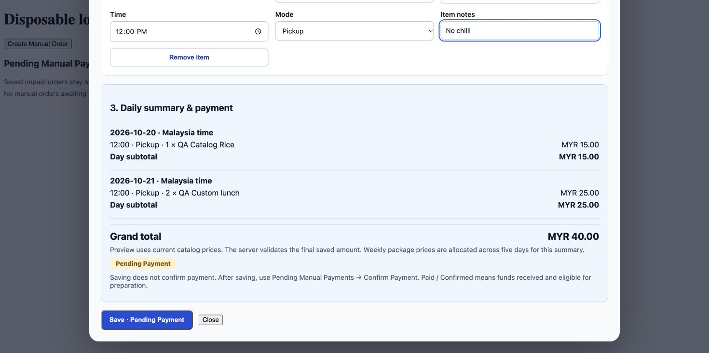
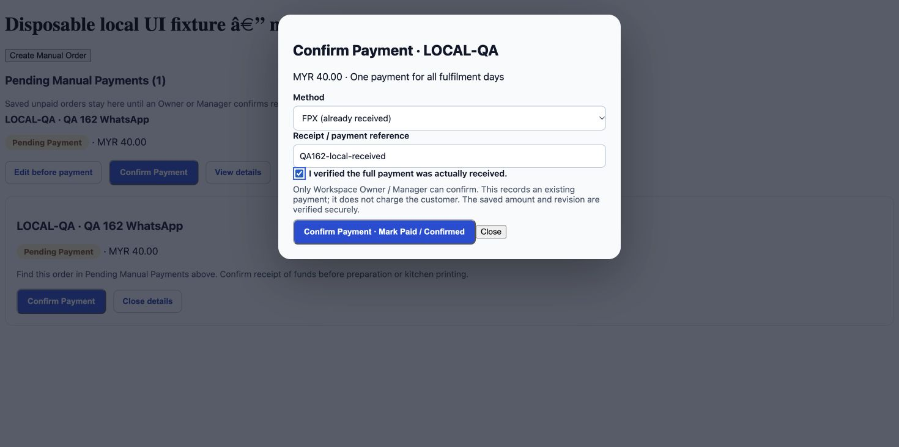
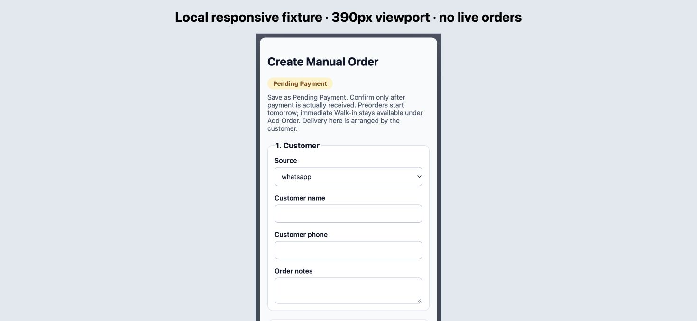

# Issue #162 — Manual POS Beta UAT fixes

The Manual Order dialog now has responsive Customer, Schedule & Items, and Daily Summary & Payment sections. New drafts visibly start Pending Payment. Default Malaysia date/time are visible before adding items; each item retains its own schedule, quantity, options, and notes. Daily subtotals and a grand total use the existing catalog/option/set pricing helpers; weekly package cents are allocated across five days only for the planning summary. Saving still computes authoritative prices on the server.

Pending Manual Payments shows saved amounts and an obvious Confirm Payment action, plus edit/details. Paid / Confirmed active orders remain discoverable in a separate list and details. These labels describe the existing payment/status combination, not a new backend state. Confirmation still checks Owner/Manager authority, exact saved amount, revision, reference and explicit funds-received acknowledgment transactionally. FPX is an additional manual receipt method, not gateway capture.

Catalog loading is visible; errors and empty catalogs are explicit. POS loads the complete available Store-scoped product catalog instead of the administrative first 50 records. Set selection now reads the actual `options` schema.

## Validation

- TypeScript and Beta production build passed.
- Immutable protected regression gate: 719 frontend/model tests; 451 Functions tests; Rules suites 29 Recipe, 2 Resume, 21 Chef, 8 Personal Expenses, 44 Store Payment/History. All passed, no skips.
- New tests compare catalog/modifier/custom previews against server prices, check set upgrade totals, invalid/incomplete inputs, and five-day package allocation. FPX confirmation rejects wrong amounts, stale revisions, missing acknowledgment/reference, and unknown methods; retries do not duplicate writes.
- Local browser fixture: WhatsApp order, catalog 15.00 plus custom 2 × 12.50 on consecutive dates = MYR40.00; summary and pending queue checked. Confirmation disabled until reference and receipt acknowledgment are provided. Responsive 390px iframe checked visually.
- Screenshots below are **local component fixtures with mocked service calls**, not live Beta evidence.
- Full live Beta acceptance of this new candidate remains pending protected deployment approval. Previous live candidate was a608962. Do not merge or release Production based on these local screenshots.

## Live acceptance after protected Beta release

Verify manifest source SHA matches PR candidate. In authenticated Beta, create a disposable two-day WhatsApp order with catalog plus custom item; verify totals and dates; save pending; verify queue/details and exclusion from kitchen/tickets; confirm received payment with authorized Owner/Manager; verify Paid / Confirmed, independent daily Prepare and tickets. Check small desktop/mobile and 1/3/8 A4 tickets without blank trailing pages. Remove only disposable QA records. Preserve external POS, online checkout, Curlec, Lalamove, pricing and WhatsApp. No Production deployment is authorized.
