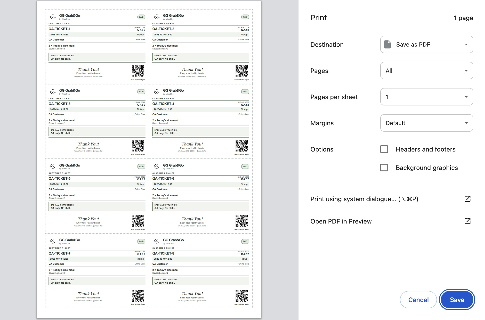
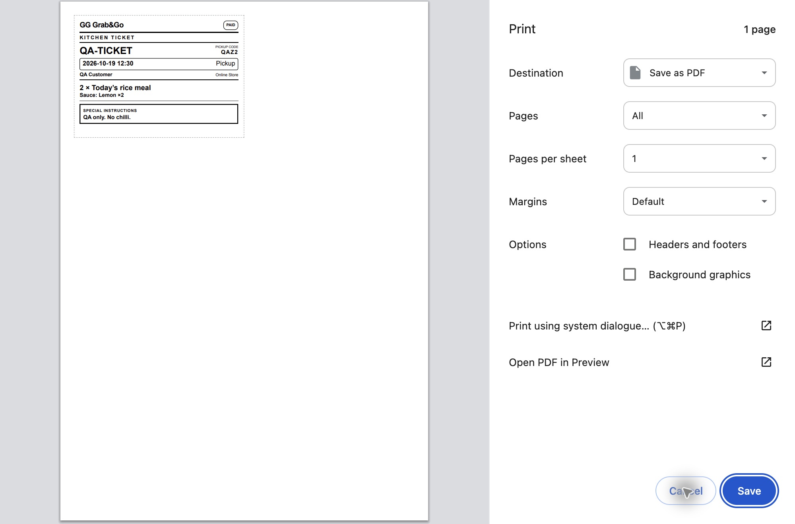

# Issue #163 — Customer and kitchen ticket redesign

Customer tickets use minimalist white/sage styling, the existing official MiseChef logo (byte-identical inline asset), actual Store name, smaller by MiseChef, customer identity, source, pickup code and actual daily schedule. Confirmed paid orders show PAID; every other payment state shows PENDING / UNPAID. Special instructions and item modifiers remain visible. Customer footer includes Thank You!, Enjoy Your Healthy Lunch! and Scan to Order Again. The QR matrix encodes exactly https://misechef.ai/store/misechef-s-grab-go-store. Kitchen tickets are monochrome with larger order/date/item text and no QR/logo/footer.

Existing daily fulfilment projection, financial privacy, state-free printing/reprinting and paid queue eligibility are retained. Weekly component item notes are now retained too. No payment, inventory, pricing, delivery or WhatsApp code changed.

## Validation

- TypeScript and Beta build passed.
- Protected regression gate: 723 frontend/model, 451 Functions, mandatory rules 29/2/21/8/44 — all passed, no skips. Additional body-class collision regression added after visual QA; 17 ticket tests pass.
- Actual Chrome native A4 print preview: 1, 3 and 8 customer tickets = 1 page; 9 = 2 pages; kitchen = 1 page. No extra blank page. Screenshots below are local fixtures generated by the candidate's actual renderer, not live customer records.
- Official logo byte parity, exact QR matrix/destination, unpaid statuses, source escaping, daily isolation, financial privacy and non-mutating reprints covered by tests.
- Overflow is measured before print; font size adapts within bounds. Oversized content blocks the Print button with a visible error rather than silently dropping text.
- Protected Beta release and live QA must verify the new candidate SHA. Production is not authorized.

