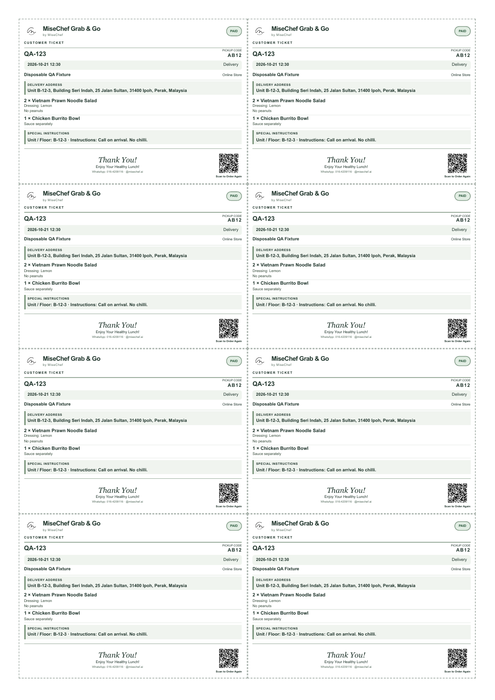

# Coordinated POS completion

The existing branch retains manual order creation/payment management under View Orders,
Today/Tomorrow/Upcoming daily allocations, authorized idempotent payment and kitchen
transitions, separate ticket printing and historical reprint pagination.

This update closes additional gaps:
- Move external Add Order into View Orders and remove full receipt actions from the daily kitchen queue.
- Let checkout customers review/edit the full delivery address after map selection. Editing invalidates the quotation and requotes with the selected coordinates and exact edited address.
- Project manual delivery addresses from their saved per-fulfilment notes, without substituting online recipient/neighbourhood data. Flag missing addresses explicitly.
- Preserve online unit/floor and instructions on customer/kitchen tickets and show the delivery address on daily POS cards.
- Offer paid customer payment receipts from Print Tickets, including customer contact, totals and all daily schedules/addresses. Existing bag tickets remain price-free.
- Compact fixed ticket spacing so full addresses, two items/options and delivery instructions fit eight aligned cells without footer overlap.

## Verification

- TypeScript passed; 52 focused POS/daily/ticket/receipt tests passed, no skips.
- Native headless Chrome A4 checks use disposable local fixtures, not customer data.
  Customer batches of 1/3/8 print on one page; 9 print on two pages.
  Eight kitchen tickets print on one page. Full-address customer screenshot below.
- Full protected candidate validation, baseline/live-fingerprint check and Beta build
  must pass for the exact final SHA before release. Use the protected Beta Release
  workflow and required environment approval; no direct Firebase deployment.
- Live Beta acceptance remains dependent on protected deployment and authenticated
  workflow verification. No Production release is authorized.

